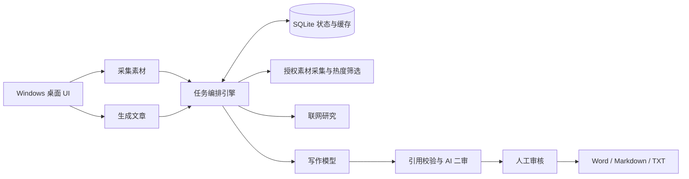
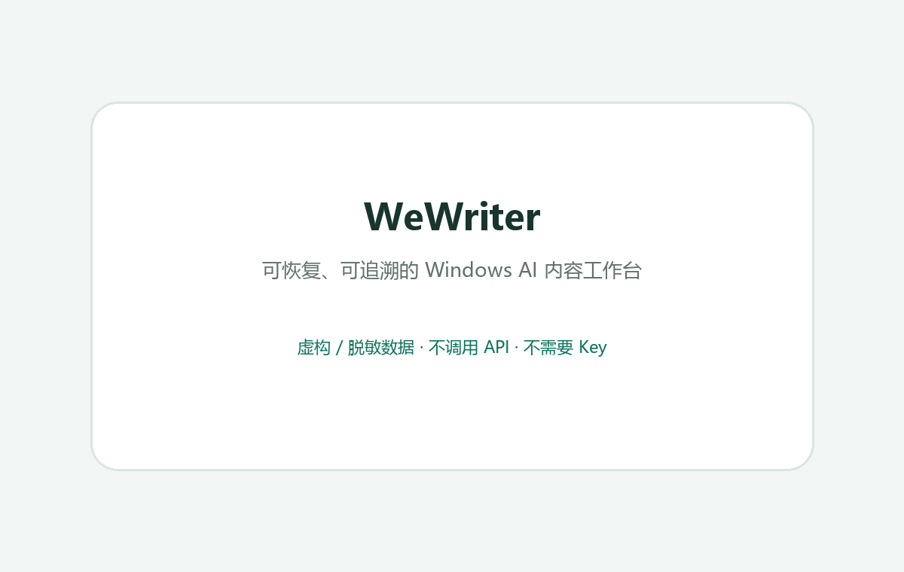

# WeWriter v0.10.4｜可恢复、可追溯的 Windows AI 内容工作台

[](https://github.com/tudou0655-alt/wewriter/actions/workflows/test.yml)
[](https://www.python.org/)
[](#运行-demo)

> 面向企业内容运营：把“授权素材采集 → 热度筛选 → 联网研究 → AI 写作 → 人工审核 → 导出”变成可恢复、可追溯的桌面工作流。程序在客户 Windows 电脑本地运行，无需部署数据库服务。

[下载 Windows v0.10.4](downloads/WeWriter-v0.10.4-Windows.zip) · [24 秒免 Key 功能演示](#24-秒免-key-功能演示) · [虚构稿件样例](docs/showcase/articles/sample-1.md) · [运行 Demo](#运行-demo) · [详细文档](#详细文档)

> 合规边界：仅处理用户有权管理和使用的账号及素材；采集与发布须遵守平台规则；AI 输出必须经人工审核。公开 Demo 全部使用虚构或脱敏数据。

## 30 秒看懂项目

人工运营常在多个网站、文档和模型之间搬运信息，任务耗时长，任何一步失败都可能导致整条流程重做。WeWriter 用本地 SQLite 保存任务状态、可复用的中间结果和来源关系。工作台将“采集素材”和“生成文章”分开：采集更新本地素材库，写作从库存选文，不会再次查询公众号列表。稿件均须人工审核；默认优先保存可修改草稿，自动二审、查证和风格改写需关闭该模式后才执行。



### 3 个技术难点

| 难点 | 解决方式 | 可核验结果 |
|---|---|---|
| 长流程易失败、模型调用可能重复计费 | SQLite 持久化任务状态；采集与写作分开；正文、摘要和部分研究结果可复用；付费请求次数可设上限 | 候选不足时停止后续研究和写作；已发生的采集请求仍可能计费 |
| 生成内容缺少依据 | 公众号来源 `[S]` 与联网来源 `[W]` 关联；直接引语回查；严格模式可执行 AI 二审和查证 | 默认草稿优先模式跳过自动二审与查证，稿件需人工核实后发布 |
| Windows 客户端交付与本地安全 | DPAPI 加密 API Key 和登录状态；诊断脱敏；版本化 SQLite 迁移；PyInstaller 打包 | 已有本机测试包与离线交付检查；正式客户验收及代码签名仍需完成 |

**当前状态（2026-10-28）：** Python 3.13 · Windows；支持单次任务生成 1–5 篇稿件。离线交付检查 6 项通过；本地 499 项非浏览器测试中有 8 项失败、1 项错误，另两组浏览器页面测试因本机浏览器启动停滞未完成。部分旧测试仍按拆分前流程或严格模式断言，尚未逐项修复与复验。上方 CI 徽章反映 GitHub 自动测试结果，不代表客户机验收。稳定产出目标篇数、事实可靠性及费用上限仍需实际验证。

技术栈：Python 3.13 · OpenAI Responses API · DeepSeek · pywebview / WebView2 · Playwright · SQLite · python-docx · PyInstaller。

## 24 秒免 Key 功能演示



此 GIF 根据软件自带的虚构演示用例绘制，是功能示意而非真实运行录屏；账号、文章和稿件名称均为样例。实际演示模式使用独立数据库，不调用采集服务或模型接口。当前界面和交互以运行中的程序为准。

Windows 包由提交 `11c1064` 的干净源码构建，内含 EXE、安装脚本、README 和构建清单；SHA-256：`00651127A989955B72E94865DF341823964598A85D96E4BEFBE4B6C4129FB5ED`。该包未签名，正式客户分发前仍需处理 Windows 签名与客户机验收。

## 详细文档

<details>
<summary><strong>详细文档：客户使用、失败恢复、安全、开发与版本记录</strong></summary>

### 生成示例

以下稿件使用程序内置的虚构公众号与文章名称，只用于展示内容结构和来源追溯；不代表实际模型输出质量。

- [让每日阅读变成可追溯的创作素材（虚构演示稿）](docs/showcase/articles/sample-1.md)

## 客户使用

界面共五页：工作台、公众号、文章库、稿件库、设置。所有时间按中国时间（UTC+8）显示。

1. 解压 `WeWriter-Windows.zip`，双击 `WeWriter.exe` 即可运行。若 Windows 11 提示“智能应用控制已阻止可能不安全的应用”，是因为该版本未做数字签名，请联系开发方获取签名版，或按开发方说明临时关闭智能应用控制。也可以右键 `install.ps1`，选择使用 PowerShell 运行，将软件复制到当前用户的程序目录并创建桌面快捷方式。组织策略限制脚本时，直接运行 EXE。
2. 在手机微信读书 App 中把目标公众号加入书架。软件只同步**微信读书书架**里的公众号，不是微信关注列表。
3. “公众号”页点击“扫码同步书架”：首次会打开专用 Edge 窗口，用同一微信账号扫码；登录状态加密保存在本机，之后重启无需再扫。读取书架后勾选要导入的公众号；已在名单中的保留原有启用状态。也可“手动添加”：填写公众号名称和该号任一文章链接（从链接里的 `__biz` 识别账号）。
4. “设置”填写 DeepSeek Key，即可使用默认的 DeepSeek 原生搜索、摘要和写作。可手动切换 OpenAI GPT 或阿里云百炼并填写对应 Key；切换只对新任务生效。采集历史文章与阅读量建议填写极致了 Key（EveryInfra 可作备用）。没有数据服务 Key 时仍可尝试微信读书通道，但文章列表可能返回 `-2041`。
5. “工作台”有两个独立入口：“采集素材”按今天 / 近 24 小时 / 近 3 天读取文章列表、保存标题与阅读量，不调用写作模型；“生成文章”从本地素材库挑选符合阅读量门槛且未写过的文章，按需读取尚未保存的正文，再研究和写作，不重新读取公众号列表。可多次使用已采集素材生成不同文章，但已用于稿件的文章默认不重复选用。运行时新任务会加入队列；停止任务保留已有稿件。上次退出前未开始的排队任务需手动开始。
6. 在“稿件库”查看、编辑、审核：保存修改后回到待审核；“审核通过”需确认，只有人工通过的稿件计入工作台的合格篇数。默认“优先生成草稿”会跳过自动二审、查证和风格改写，篇幅或引用不足会标明待处理；需要严格流程时可在设置关闭。导出支持 Word、Markdown、TXT，发布稿不含内部来源编号，素材报告另存可追溯依据；也可用“复制全文”粘贴到编辑器。
7. 确认手动运行正常后，可在“设置 → 更多设置与维护”启用每日定时写作；定时任务只用已保存素材，不自动采集。按需开启“登录 Windows 时启动软件”。关闭窗口选择“是”，软件继续在托盘运行。

默认采集范围近 24 小时，单账号最多查询 24 篇；写作从素材库按阅读量选择尚未使用的文章，默认生成 3 篇约 1500 字的独立稿件。篇幅可自由填写 200–20000 字（是写作目标，不是字数保证）。素材库只代表管理的公众号及已采集范围，不是全网榜单。

## 每篇独立联网写作

每篇文章单独处理素材，再用所选服务的联网搜索查找相关补充资料，由所选模型独立写作，不跨主题合稿。默认使用 DeepSeek 原生 Search 接口；公众号来源标为 [S数字]，联网来源标为 [W数字]，素材报告保留对应关系。联网失败时会明确标注降级，不能把未检索到的内容冒充联网事实。搜索摘要和模型整理的网络资料仍需人工审核。

联网搜索、摘要和写作可分别选模型。默认只需要 DeepSeek Key；选择 OpenAI 或百炼时需要相应 Key。搜索与模型调用均可能计费；设置和任务的金币面板显示按模型及用量估算的金额，具体以服务商账单为准。基础费率和核对日期见 `docs/collab/T047_RATES.md`。

每篇拥有单独任务与缓存。批次“部分完成”可重试，已完成文章不会重复生成，失败篇尽量复用已保存的正文、摘要和研究结果；尚未落库的阶段仍可能重新调用服务。想重新检索最新信息请新建任务或在稿件页重新生成。若符合条件的新文章不足目标篇数，会如实显示不足，不拿旧稿凑数。

新任务默认使用 DeepSeek。已创建任务继续使用保存时的模型配置，避免重试时悄悄更换计费服务商；要体验新默认配置请新建任务。阅读量缺失的旧素材在最低阅读量为 0 时排在已知数值之后；提高门槛后不参与选文。最低阅读量默认 0，可在设置修改。

## 清理与检索（v0.6.0）

- 文章资料库：Ctrl/Shift 多选或全选当前列表后清理，也可一键清空整个资料库。清理正文、摘要和相关缓存，保留已生成稿件及其报告。
- 稿件工作台：可按标题或正文关键词检索，每页 50 篇；单选打开编辑，Ctrl/Shift 多选清理，支持全选本页和一键清空全部稿件。稿件清理同时清除正文、素材报告与历史版本，保留文章资料库。
- 清空全部始终涵盖搜索结果之外的记录，确认框会显示范围与数量。正在运行任务时禁止清理。
- 清理无法在界面撤销，需要留档时先导出或备份。数据库保留最小标识及清理记录，防止同一素材自动回流或原任务再次生成；已清理素材不能用于重新生成，现有稿件仍可编辑导出。SQLite 文件体积不保证即时缩小。

## 数据与密钥

- 数据文件：`%LOCALAPPDATA%\WeWriter\workspace.sqlite`。
- API Key：同目录 `keys.dpapi.json`，由 Windows DPAPI 加密，仅原 Windows 用户可解密。普通数据库中没有密钥。
- 原文、摘要、稿件与历史版本保存在本地；原文发送至摘要模型，摘要及证据片段发送至写作模型。API 服务有各自的数据处理政策。
- 原文图片保存在数据目录的 `article-images` 文件夹。正文不足 100 字的图片型文章默认跳过，由下一篇热门文章补位；在“设置 → 采集与写作”勾选“识别图片型文章”后，才会均匀选择最多 8 张压缩图片发送给 OpenAI 识别并缓存转写结果（额外 API 调用）。其他文章的图片不发送给模型。SQLite 备份不包含图片文件；恢复备份后可在文章资料库多选文章并执行“补采所选图片”。
- 设置页提供备份、恢复和打开数据目录。备份不包含 API Key；换电脑后重新配置密钥。
- 任务结果、警告、采集漏斗中的失败原因和文章处理提示在写入数据库前统一脱敏（Bearer、API/Skill Key、Cookie、微信读书临时验证头等），界面展示时再脱敏一次；错误类型、HTTP 状态和请求编号保留。升级到 0.10.4 时数据库会一次性清理这些历史诊断字段，恢复旧备份时同样清理；文章正文、稿件正文和素材报告不做替换。
- 恢复前自动备份现有数据库，恢复后默认关闭定时，避免意外执行。
- 删除公众号只删除关注配置，保留文章和稿件。

## 定时与失败处理

- 关机、退出软件、休眠期间无法执行。恢复运行后合并补执行最近一次遗漏的定时写作任务；它只使用已保存素材，不会补采离线期间的新文章。
- 同一天定时任务只创建一次，失败需要手动重试，不会不断重复扣费。
- 运行记录中的“继续原任务”沿用原配置、原采集时间窗和已选文章，复用已经获取的正文与逐段摘要，已完成的稿件不会重复生成，也不会重新读取文章列表。
- “重新采集”会新建一个只更新素材库的任务：使用当前采集时间范围重新读取公众号列表；原任务和稿件保持不变。采集服务可能按次计费，不会自动写稿。
- 不同数据服务和模型接口有各自的有限重试规则；设置中的“付费请求次数上限”包含采集、模型、搜索和重试请求，只限制次数，不保证人民币金额上限。
- 任务期间可以停止；正在进行的请求通常需等待返回，联网搜索请求超时为 300 秒，其他接口为 100 秒。

联网搜索发生连接失败或超过 300 秒时，该篇自动降级为仅基于公众号原文生成，并在任务警告、稿件审核提示和素材报告中标明“未使用联网资料”。批量任务即使篇数达成，只要有子任务降级或带质量提示，结果会以“【需复核】”开头并分别写明降级篇数和提示篇数，状态列显示“已完成（有提示）”；采集阶段的提示（如达到单账号上限、降级采集）会保留在批量任务警告中，重试时按最新结果替换，不会重复累加。API Key 无效、余额不足、权限错误或响应格式异常不会降级，以免掩盖配置问题。

## 采集范围与审核

公众号同步读取微信读书书架中的公众号条目，历史列表采集优先使用已配置的极致了服务，EveryInfra 可作备用；均不可用时可尝试微信读书通道。读取正文时仍可能使用微信读书或公众号原文。登录状态和本地 API Key 经 Windows DPAPI 加密保存，备份不包含凭据。若微信读书文章列表返回 `-2041`，重复扫码通常不能解决服务端拒绝；任务会如实提示实际采集方式与覆盖范围。

任务详情的“各公众号”逐个写明采集方式、返回篇数和跳过原因；如降级为“仅最新一篇”，会附原因和该文章发布时间（中国时间）。扩大时间范围只改变筛选条件，不能保证恢复历史列表覆盖。

微信读书文章列表曾在官方网页和程序中同时返回 `-2041`。该服务端拒绝的具体触发机制未获证实；出现时不要反复扫码或密集重试，可检查数据服务配置及任务详情的降级说明。

阅读量与点赞量记录接口数值、来源及采集时间（中国时间）。接口返回 0 视为有效的 0；字段缺失或格式无效记为“未知”，不会伪装成 0。文章库分别更新两项指标，缺失或无效值不会清空已有有效值。已知问题：曾有页面显示阅读 1068、软件显示 0，原始差异原因尚未查明。

若出现 `-2010` 或 `-2012`，在“公众号”页点击“扫码同步书架”重新登录。若出现 `-2041`，可在设置中配置极致了 Key 获取文章列表与阅读量。设置页不再提供微信读书 Skill Key 输入框。当前部分手机微信读书版本没有“设备管理”，无需寻找该入口。

保存极致了 Key 时，采集优先使用可翻页的 `post_history` 历史发文接口；每个公众号可能产生多次付费请求，实际价格和账单以服务商为准。极致了失败时可使用 EveryInfra 备用；数据服务均不可用时按任务详情提示处理，不保证每次都能取得足够候选。软件中移除公众号不会取消手机端关注；再次同步书架可能重新导入。

- URL 去重与相同正文去重；写过的文章不自动重复使用，可在稿件页“重新生成”显式复用原素材。
- 模型引用必须能在原文找到，正文来源标记必须属于输入来源。这是结构与引用检查，不能证明事实正确或文章原创性，稿件仍需人工审核。
- 导出支持 Word / Markdown / TXT；不包括自动发布、邮件推送或多用户共享。

## 运行 Demo

命令：`WeWriter.exe --demo`。使用独立的 `WeWriterDemo` 数据目录，包含明确标注的本地样例，不调用 API，不运行定时。

## 开发与测试

```powershell
python -m venv .venv
.\.venv\Scripts\python.exe -m pip install -r requirements.txt
.\.venv\Scripts\python.exe main.py
.\.venv\Scripts\python.exe -m unittest discover -s tests -v
.\.venv\Scripts\python.exe main.py --demo --data-dir .local-data\demo --smoke-test .local-data\ui-smoke.json
powershell -ExecutionPolicy Bypass -File scripts\build.ps1
```

打包结果：`dist\v<版本>\WeWriter.exe` 与 `dist\WeWriter-v<版本>-Windows.zip`。版本号只在 `wewriter/__init__.py` 定义，构建脚本、界面和离线校验都读取它；构建时生成 `build-info.json`（版本、源提交、工作区是否含未提交改动、中国时间），随 EXE、发布目录和 ZIP 一起交付，打包后自动校验包内容。界面侧栏和“设置 → 数据管理”显示版本及“干净提交 / 含未提交改动”。EXE 暂未进行代码签名，首次运行可能显示 Windows 发布者提示；对外交付建议签名并在客户机器验收。

## 接口资料

- https://everyinfra.com/docs
- https://api.everyinfra.com/api/v1/social/catalog
- https://api.everyinfra.com/api/v1/search/tools
- https://api.everyinfra.com/openapi.json
- https://developers.openai.com/api/docs/models/gpt-5-mini
- https://api-docs.deepseek.com/

公开接口目录快照保存在 `docs/`。真实凭据不应提交到版本库或发到聊天中。

联网接口依据：https://developers.openai.com/api/docs/guides/tools-web-search

## 评论分析（已停用）

自 T-010 起不再使用 EveryInfra 评论分析：新任务、重试、定时任务和旧配置中的评论开关都不会再获取评论或调用评论分析模型。历史素材报告里已有的评论分析保留不动。EveryInfra 的文章列表/阅读量备用通道不受影响。

版本验证：OpenAI 响应解析、搜索引用、旧配置迁移和评论校验已用模拟响应测试；真实 OpenAI 调用需先在设置保存 Key。

## 历史版本记录（非当前操作说明）

以下内容保留旧版本的改动背景；旧菜单路径、服务商及默认行为可能已经变化。当前用法以本文前面的“客户使用”“定时与失败处理”和“采集范围与审核”为准。

### 允许重新采集（v0.6.1）

设置 → 采集与逐篇写作 → 勾选“允许重新采集已清理文章” → 保存全部设置 → 概览“立即采集并生成”。默认关闭；只对使用新设置的新任务生效。已清理文章仍受时间范围、阅读量排名和单次篇数限制，入选后重新获取正文并用于生成，即使以前曾生成过稿件。原有稿件不受影响。重新获取完成的文章恢复正常去重，后续任务不会一直重复生成；旧任务重试仍沿用旧配置。

版本 v0.6.2：修复 OpenAI JSON 模式输入缺少 JSON 字样导致 HTTP 400 的问题。失败任务可直接重试。

版本 v0.7.0：统一界面配色、留白和表格行距；低频操作收纳到所在区域右侧的“更多操作”菜单。设置分为模型与联网、采集与写作、自动运行、数据管理四页，保存按钮固定在底部。清理、模型测试、历史版本、重新生成等功能仍保留。

版本 v0.7.1：移除 EveryInfra 文章采集入口，采集和采集测试统一使用微信读书；保留 EveryInfra 评论功能。

版本 v0.7.2：摘要引用允许中文字符间排版空白、连续空白及弯直引号差异，保存时还原原文片段；不忽略数字、字词或普通标点变化。引用不匹配时最多额外调用摘要模型纠正一次（可能计费），仍不匹配则明确报错，不降级放行。此校验仅验证引用存在，不证明观点与引用的语义关系。

版本 v0.7.4：摘要校验忽略空白和标点差异，保留匹配成功的事实并舍弃单条异常引用；全部引用连续两次失败时，改用原文连续片段作为可追溯证据。联网搜索超时延长至 300 秒，连接失败或超时后自动降级为仅基于已有公众号内容生成。

版本 v0.7.5：新增 `WeWriter.exe --clear-data` 清理命令。运行后弹出确认，自动备份数据库，再清空公众号、文章、稿件、任务记录与分析缓存；保留 API 密钥、微信读书登录状态和设置，并暂停定时任务。软件正在运行时该命令不会取得实例锁，请先退出软件。

版本 v0.7.6：增加小屏自适应。窗口按屏幕可用尺寸启动；在较小屏幕上自动缩窄侧栏与边距、缩短表格和稿件编辑区，并为所有表格提供横向滚动条。设置页继续使用独立滚动区域，弹出正文与扫码窗口不会超过屏幕尺寸。

版本 v0.8.0：增加可关闭的“生成后 AI 二审”。二审会对照原始证据复核事实边界、标题、结构和表达，减少公文套话、重复结论和过度确定的推断；失败时保留初稿并提示人工复核。每篇二审会增加一次写作模型调用。稿件正文不再保留模型重复生成的来源章节，参考网站仍可在工作台查看并随导出生成。微信读书登录改为专用 Edge 窗口，并在保存前验证书架与公众号文章接口；正式采集复用加密保存的登录状态，不重复启动 Edge。

版本 v0.8.1：重做视觉层级和主要操作流程。使用更明快的橙紫配色、彩色数据卡片、编号创作流程和图标导航；公众号连接改为“扫码登录 → 同步公众号”两步，手动添加默认收起；文章、稿件等页面把清理和其他低频操作合并到单个“更多”菜单。稿件保存与导出固定在编辑器上方，小屏幕也能直接看到。

版本 v0.8.2：使用原创动漫小猫头像作为应用图标，覆盖 EXE 文件、窗口标题栏、Windows 任务栏、系统托盘和安装后的桌面快捷方式。图标使用透明背景并包含 16–256 像素的 Windows 多尺寸资源。

版本 v0.8.3：修复专用 Edge 异常退出后锁住登录目录、再次点击扫码立即失败的问题。每次扫码登录使用独立临时浏览器目录，结束后自动清理；界面同时直接显示经过处理的登录与网络错误，不再统一隐藏为“内部错误”。

版本 v0.8.4：修复点击“Edge 扫码登录”后只显示 MSN 新标签页的问题。Edge 启动时直接打开微信读书，连接后再次校验地址并将登录页切到前台，同时关闭本次临时会话中的空白页。

版本 v0.9.0：公众号正文处理时同步提取原文图片，校验可信图片域名和文件格式后下载到本地 `article-images` 目录；文章资料库显示已保存图片数量，并在正文详情中展示缩略图。旧素材可多选后从“更多”菜单执行“补采所选图片”。单张图片最多 8 MB、每篇最多 20 张，图片失败不影响正文处理；清理文章时会同时删除对应本地图片。

版本 v0.9.1：修复图片型公众号文章因可提取文字不足 100 字而被直接跳过的问题。程序会先保存原图；仅在正文不足时，通过 OpenAI Responses API 使用现有 OpenAI 模型识别最多 12 张图片，将可辨文字与画面信息作为带风险提示的素材继续摘要和写作。识别结果写入缓存，任务重试不会重复识图计费。

版本 v0.9.2：修复多图文章进入图片识别后只显示笼统 HTTP 400 的问题。单次请求改为均匀选择最多 8 张、使用模型自适应图片清晰度并降低传输体积；接口拒绝时会显示脱敏后的具体原因和 OpenAI 请求编号，便于区分模型权限、图片校验与参数问题。

版本 v0.9.3：修复 OpenAI 图片识别启用 JSON 输出模式时，输入消息缺少显式 `JSON` 标记而被接口以 HTTP 400 拒绝的问题。更新后可直接重试原失败任务，无需重新采集图片或清空数据库。

版本 v0.10.0：重构采集与独立写作流程。一次批量任务只建立一个 Edge/微信读书会话，公众号同步、正文读取和热度补位顺序复用，不再为每篇子任务反复启动 Edge；会话意外中断时在采集层自动重建一次。每次任务重试会清空上一次执行产生的警告，只展示本次结果，同一素材不会再因多次重试堆叠互相矛盾的历史提示。

版本 v0.9.10：Edge 采集窗口的启动等待时间由 10 秒延长到 30 秒，首次启动失败会使用新的临时配置自动重试一次；错误提示会区分未安装、启动超时和安全软件拦截。微信读书对单篇文章返回验证页时，仍会自动尝试公众号原文链接，并在原文不可用时由后续热度文章补位。

版本 v0.9.8：将微信读书业务码 `-2010` 明确识别为登录凭据未对应有效用户，并提示使用同一微信重新执行 Edge 扫码登录。扫码后的书架验证连续失败会立即给出恢复步骤，不再一直等待到登录超时。

版本 v0.9.7：独立生成模式保留完整热度候选队列；前三篇中如有文章正文提取失败，会按热度顺序自动使用第四篇及后续文章补位，尽量生成设定的篇数。写作与二审同时禁止并自动清理“如果你愿意，我可以”“请把资料发来”等聊天式后续服务邀约。

版本 v0.9.6：修正 `-2041` 的处理提示。当前部分手机微信读书版本没有“设备管理”，用户只需重启重试，必要时在公众号管理中使用 Edge 重新扫码登录。

版本 v0.9.5：修复“分别生成多篇”时采集任务与写作子任务共用 Edge 配置目录导致的启动冲突。每个采集会话现在使用独立临时目录并在结束后自动清理，刷新后的登录 Cookie 仍会保存到本地加密凭据中。

版本 v0.9.4：采集、同步公众号、测试公众号和正文补采统一通过本机 Edge 会话访问微信读书，让网页自动刷新公众号接口的临时验证凭证。已保存的登录 Cookie 会安全注入独立浏览器会话；遇到 -2041 时通常无需清理数据库，只有网页会话本身失效才需要重新扫码。

版本 v0.10.1：稳定性更新。
- Edge 采集窗口：关闭时通过 CDP 让 Edge 真正退出并结束整个进程树；临时配置目录等待文件锁释放后再删除，启动时自动清理残留目录。同一次任务复用一个微信读书页面读取正文，不再每篇重新加载首页。
- 微信读书 `-2041`（临时验证凭据失效）或正文请求非 200 时，先自动重新加载页面/续期凭据并重试一次，仍失败才提示重新扫码。
- 诊断日志：数据目录 `logs\wewriter.log`（自动轮转，不记录密钥、Cookie 和正文）。程序异常会记录完整堆栈，界面提示错误类型与日志位置。
- 运行记录新增“错误类型”列，详情页给出处理建议；任务失败原因以结构化错误码保存（`jobs.error_code`），补位判断不再依赖报错文字。
- 稿件未通过来源标记或 JSON 格式校验时，自动带着错误原因重写一次（最多多一次写作调用）。
- 单篇文章出现意外异常时只记该篇失败，批次继续处理其余文章；单独重试某篇后，所属批次状态自动更新。
- 连接阶段失败（DNS、连接被拒）及 HTTP 502/503 自动有限重试；超时、500、504 仍不重发，避免重复计费。
- 文章列表中个别条目缺少标识或发布时间时跳过该条，不再导致整个公众号采集失败。
- 模型 Key 缺失时在采集前即报错，不再先采集、摘要后才失败。任务运行中选择退出，当前请求结束后自动退出。
- 内部结构：任务流程拆分为采集、素材、风格、评论、联网、写作、报告等独立步骤，各自缓存。

版本 v0.10.2：接入微信读书官方 Skill Key。书架同步改用官方 Skill 鉴权；历史文章列表出现 `-2041` 时，自动获取各公众号最新文章及其真实发布时间、阅读量和点赞数继续筛选。正文临时凭据失效时直接读取公众号原文。Edge 扫码登录不再因文章列表接口短暂失效而判定登录失败；设置页可保存和清除 Skill Key，并在任务中明确标出降级采集。

版本 v0.10.3：移除“跳过促销、直播带货类文章”和促销关键词配置。采集与热度补位不再按标题过滤文章，旧数据库中的相关设置会自动丢弃；图片型文章是否调用 OpenAI 识别仍由独立开关控制。

版本 v0.10.4：交付可靠性与采集可信度更新。
- 持久化诊断统一脱敏，并一次性清理历史诊断字段（数据库版本 4）。
- 阅读量记录来源、观察时间和“有效 / 缺失 / 无效”状态；合法 0 与未知分开显示，未知不参与热点排名。
- 批量任务保留采集提示，并汇总子任务联网降级和质量提示；篇数完成与质量提示分别表述。
- 每个公众号标明“历史列表”或“降级：仅最新一篇”及其限制。
- 运行记录区分“继续原任务”和“按当前配置新建采集”。
- 版本号单一来源，构建清单记录提交与工作区状态。

已知限制：页面阅读量 1068 与软件 0 的差异尚无原始响应证据，本版只保证如实记录接口返回值及其来源，未修改字段选择。需要用户提供脱敏后的对照材料后再判断。

</details>
